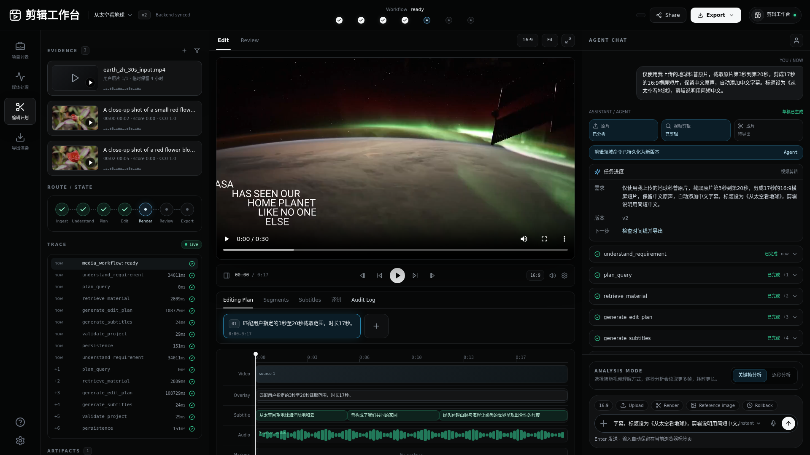
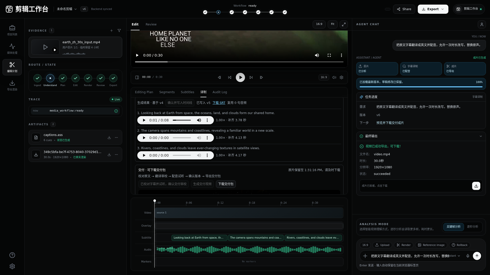

# 剪辑工作台

[简历固定版本](https://github.com/yeruoxiangchen/video_studio/tree/resume-20261116) · [最新代码](https://github.com/yeruoxiangchen/video_studio/tree/main) · [版本与评测记录](docs/versions.md) · [操作演示](docs/demos/README.md)

用文字完成视频剪辑，再把同一条时间线译制成英文视频。支持直接打开「译制」面板，也支持向 Agent 发送翻译、配音指令。

## 剪辑与译制演示

| 用文字剪辑和修改 | 翻译、配音与字幕合成 |
| --- | --- |
| [](docs/demos/04-editing-workflow.mp4) | [](docs/demos/01-agent-workflow.mp4) |
| [观看剪辑过程](docs/demos/04-editing-workflow.mp4) · [对比原片和两版成片](docs/demos/05-editing-comparison.mp4) · [9 秒中文成片](docs/demos/06-edited-chinese.mp4) | [观看对话译制](docs/demos/01-agent-workflow.mp4) · [观看面板操作](docs/demos/02-panel-workflow.mp4) · [30 秒英语配音成片](docs/demos/03-earth-english.mp4) |


## 使用方式

1. 新建项目并上传带口播的原片，等待画面分析与语音识别完成。
2. 剪辑：在聊天区描述要保留的片段、顺序、时长和字幕要求；Agent 生成或修改时间线。
3. 直接译制：打开「译制」，点击「载入原片与识别字幕」，校订原文、时间和术语，再翻译、试听配音并应用结果。
4. 文本译制：在聊天区输入 `把原文字幕翻译成英文并配音，允许一次时长改写`。后台依次生成译文和配音，保存为可修改的草稿版本；仅需翻译时可输入 `把字幕翻译成英文`，已有译文时可输入 `给当前译文配音`。
5. 在「译制」中校订字幕、试听，确认交付审校，再导出视频和交付包。

交付包包含 `video.mp4`、原文/译文/双语三份 SRT、术语表和交付清单。当前部署提供一个英文音色，其他目标语言可单独翻译。

[操作与成片演示](docs/demos/README.md) · [详细交付流程](docs/business-delivery.md)

## 项目功能

- **素材导入与理解**支持原片上传、画面分析、语音识别、镜头切分和质量检测，保留素材时间范围与分析依据。
- **多模态素材检索**对素材库视频片段进行统一编码，融合语义召回、关键词检索、标签过滤和重排，支持文本与图片查询，返回可定位到原片时间段的素材。
- **对话式剪辑**通过 LangGraph 串联需求理解、素材检索、时间线规划、字幕生成及校验，将自然语言转换为选段、裁剪、拆分、排序和字幕修改等操作。
- **多轮改稿与版本管理**支持对话修改和手工编辑，保存时间线版本与修改记录，提供冲突检测、历史版本查看和回滚。
- **字幕翻译与英文配音**在同一时间线上完成原文/译文校订、术语复用、字幕翻译和逐句英文配音，支持聊天指令、面板操作、配音试听和交付审校。
- **版本联动**将字幕、译文、配音、审校及视频绑定具体版本，内容修改后提示需重新处理的环节，遇到版本冲突时保留人工修改。
- **连续任务编排**将聊天译制需求转换为有类型的工具调用，通过持久化队列衔接翻译与配音，在同一数据库事务中应用译文并创建配音任务。
- **成片渲染与交付**使用 FFmpeg 合成视频、字幕和音轨，进行完整解码验证，支持预览、下载，以及视频、原文/译文/双语字幕、术语表和交付清单的打包导出。
- **异步任务与运行监视**由独立的分析、译制、渲染 Worker 执行耗时任务，展示处理进度、失败原因和运行记录，支持取消与重试。
- **媒体预处理与资源回收**使用 C++/FFmpeg 批量抽帧，通过 pybind11 接入原片分析与叙事采样，支持时间戳与旋转处理，并限制内存占用。渲染任务持续更新心跳，取消或超时后回收对应 FFmpeg 进程组并保存记录。

聊天生成的结果保存为草稿，用户试听、校订并确认审校后导出。配音无法适配字幕时间窗时，任务会提示调整译文或时间后重试。

## 技术栈

React / TypeScript / Vite、Python / FastAPI / Pydantic、C++17 / pybind11、LangGraph、PostgreSQL / SQLAlchemy / Alembic、Milvus、MinIO、FFmpeg、Docker Compose。

当前验证使用全本地模型：Qwen 多模态嵌入与重排、Qwen 视觉分析及剪辑规划、faster-whisper 多语言识别、Qwen 翻译、Piper 英文配音。模型、权重版本和部署角色分别记录在 `infra/` 与[部署说明](docs/local-deployment.md)，权重不随源码分发。

[C++ 媒体预处理、运行计时与任务回收](docs/native-pipeline-performance.md)

## Go 网关接入

剪辑规划和字幕翻译已接入 Go 网关；两条实际浏览器旅程通过，应用、网关及账户记录的 28,214 Token 一致，残余预占为 0。[配置与记录](docs/go-gateway.md)。

## 小规模质量记录

以下为 2026-11-15 v7 固定协议的开发回归结果，本次界面及 Agent 译制编排改动沿用这些历史指标。20 条 FLEURS 录音已经用于调试；这些数字描述该固定小样本，不作为未见数据的泛化结论。

| 检查 | 结果 |
| --- | --- |
| 实际音频 → ASR → 英文翻译，20 条 | BLEU 23.86283 / chrF++ 50.45888 |
| 中文识别 | CER 6.29275% |
| 实际 ASR → 完整译制视频 | 5/5 |
| 配音组件回识别诊断 | WER 2.76498%，输入为人工中文对照路径的实际英文翻译 |
| AgenticVBench 开发回归 | 2 道选片、2 道排序，reward 均为 1 |
| 4 客户端、10 分钟稳定性 | 8/8 流程完成 |

[质量协议与完整记录](docs/localization-quality-20261115.md) · [验证记录](docs/localization-verification.md) · [评测范围](docs/public-benchmarks.md)

## 本地启动与检查

```bash
# 配置真实模型、对象存储和数据库；环境文件保留在本机。
bash scripts/studio.sh setup
# 本机配置与首次权重准备，参见 docs/local-deployment.md。
bash scripts/studio.sh compose up -d
bash scripts/studio.sh status
```

本机网页地址为 `http://127.0.0.1:18962`；远程使用时需按[部署说明](docs/local-deployment.md)转发网页及媒体端口。模型、缓存、日志、视频和数据库卷放在 `/data/zjr/camcat_studio/`；`CAMCAT_STUDIO_DATA` 可修改物理数据根目录。

```bash
bash scripts/studio.sh unit
bash scripts/studio.sh lint
bash scripts/studio.sh contracts --check
bash scripts/studio.sh test-web
bash scripts/studio.sh build-web
```

真实集成与浏览器验证需要实际 Compose 和本地模型服务。运行方法见[Agent 译制接入说明](docs/agent-localization.md)。

## 来源与许可

- 上游代码：CamCat contributors，MIT；Nova 工作区的布局与设计继续沿用上游实现。
- 本项目：在上游基础上增加译制、业务交付、任务编排及对应验证。
- 视频、音色、模型各自保留来源与许可链接，参见[演示来源](docs/demos/README.md)、[媒体清单](docs/media-licenses.json)和[译制依赖说明](docs/localization-notices.md)。代码的 MIT 许可不替代第三方素材及模型条款。
