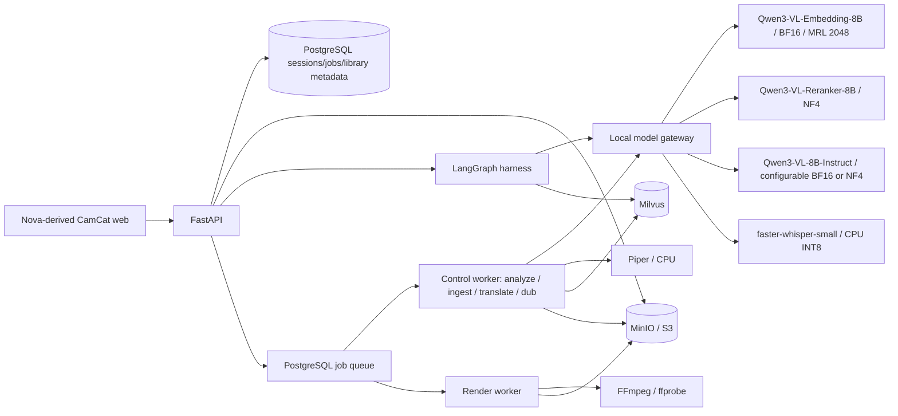

# CamCat architecture

CamCat Studio adds translation/dubbing jobs to the existing PostgreSQL queue and
applies reviewed results through the same domain commands, CAS versions and audit
patches. Generated speech is session-scoped media rendered by the V2 compiler;
the retrieval/Agent workflow below remains the foundation. See
[localization design](localization-implementation.md) and [operations](localization-operations.md).



PostgreSQL is authoritative for licensed library metadata, projects, jobs, editing sessions, immutable state versions, patches and audit events. User originals are never `Asset` or `Segment` rows: their temporary MinIO references live only in the four-hour analysis job/session context. One PostgreSQL-advisory-lock maintenance leader deletes the known expired object keys without bucket scans, redacts job payload/results, audit patch values and every state version, and marks the session expired. MinIO's `temporary/` lifecycle rule is the durable deletion backstop. Successful and non-render job runtimes are removed immediately; failed render runtimes retain bounded diagnostic evidence for 24 hours before maintenance removes them.

Jobs use idempotency keys, bounded attempts, exponential backoff, leases and heartbeat renewal. An expired lease is eligible for `SKIP LOCKED` reclaim; an exhausted job becomes `dead_letter`. API cancellation is observed at every progress/checkpoint boundary. Ingestion derives asset and segment UUIDs from licensed provenance and time ranges, overwrites deterministic object keys, publishes Milvus rows only after segment analysis, and removes partial database/vector/object state when its retry budget is exhausted.

Compose runs two workers with disjoint job-kind filters in the same PostgreSQL
queue. `compose-control-1` handles analysis, ingestion, translation and speech;
`compose-render-1` handles FFmpeg renders. Each lane executes one job at a time,
so export can overlap control work without adding GPU model processes. Only the
control lane runs maintenance. Standalone `CAMCAT_WORKER_ROLE=all` retains the
single-worker entry point. Checkpoints and heartbeat renewal commit together.

Media URLs use real S3 signatures in a per-ObjectStore, thread-safe LRU cache of
at most 2048 entries. Keys include object key, lifetime and download disposition;
entries live for the smaller of 30 seconds and one tenth of the signed lifetime.
Ownership checks and current database state are evaluated on every API request.

## Editing policy

The source-video analyzer uses FFprobe, scene detection, real direct-video visual analysis,
ASR, FFmpeg blur measurement and frame signatures. It reads thumbnail, audio and quality
windows directly from originals without encoding disposable full-resolution clips.
The existing Qwen visual client analyzes each original once. Its validated facts retain
the media ID, model and whole-media time range; this scope is explicit so a file summary
is never presented as a precise observation of every analysis window. User originals and
their analysis remain transient and are never inserted into the library or Milvus.

Planning groups analysis windows by original file and supplies its filename, measured
full range, bounded visual description and window references. It retains files even if
their individual shots were deduplicated. Storage keys and duplicate source metadata
are excluded from the model context. A request for zero external footage skips library
providers in editing mode. The original user instruction is preserved in full.

LangGraph emits typed V2 domain commands. Delivery requirements cover transitions,
subtitles, complete original clips, all-source inclusion and explicit clip counts.
Explicit bans and latest corrections are checked before persistence; forbidden subtitles
also disable automatic subtitle insertion. The planner and native compiler share the
same frame-rounded source-range and transition-handle calculation. Invalid combinations
receive bounded repair feedback before a version can be saved. The reducer additionally
enforces user footage as the primary story and the external-material ratio. Source shape
plus platform intent selects 16:9, 9:16, 3:4, 4:3 or 1:1.

The local Qwen processor counts the actual input before GPU transfer and generation.
Input over the configured 12288-token budget returns HTTP 422 with
`context_budget_exceeded`, the measured count and limit. Provider retries therefore
exclude that deterministic input error. Provider logs record input/output token counts
and suppress upstream informational messages containing signed media URLs.

Planning validates both the command schema and its simulated effect before proceeding.
Requirement understanding also selects an operation scope. Existing timing, text,
transform and audio edits use a compact contract with actual segment IDs. Structural
or unknown scopes receive the full native contract; compact plans can explicitly
request that contract when needed. Planning context supplies source start/duration,
speed and absolute source midpoints so splitting uses the native coordinate system.
An invalid source, track/segment reference, command order or external-footage ratio is
returned to the model with its previous proposal for one repair attempt. Each attempt
starts from the same immutable project; only a fully validated batch reaches persistence.
If initial planning still fails transition, visible-timeline or primary-footage
validation after that repair and its source references have been verified,
one final call asks the real model to choose a bounded range from the uploaded
footage. The existing primary-clip adapter and all domain/visible/source checks
validate this basic edit. `planning_recovery` records its use; an invalid choice
still fails. Revision plans retain their two-attempt validation budget.
Repair feedback contains the last valid simulated track/segment order, existing transitions
and legal adjacent pairs with duration limits. Diagnostic logs contain IDs, timing and
validation reasons, excluding source transcripts and subtitle text.
Server-owned source registration covers retrieved video and the session's licensed audio
catalog. It collects references from segment insertion, audio insertion, populated new
tracks and media replacement, and registers only the referenced approved sources before
applying the model's commands. Storage keys and license metadata come from the registry.

Each graph node is emitted as a numbered SSE event and persisted in `graph_runs`; the replay endpoint accepts an event cursor. The final command batch is written by the graph's explicit `persistence` node and remains atomic and versioned. The repository derives the RFC 6902 audit patch internally. `/jobs/{id}` polling remains the recovery source of truth for analysis and render tasks.

## State concurrency

An edit request contains `base_version` and typed domain commands. The reducer validates them and computes the authoritative V2 state; the repository derives an RFC 6902-style audit patch, then executes a compare-and-swap update:

```sql
UPDATE editing_sessions
SET current_version = :base_version + 1
WHERE id = :id AND current_version = :base_version;
```

Exactly one concurrent writer can update the row. A zero-row update becomes HTTP 409 with expected/current versions and the latest patch metadata. The successful transaction appends `state_versions`, `state_patches`, and an audit event. Rollback computes a compensating patch to a historical document and appends a newer version; history is never deleted.

## Retrieval

The same Qwen3-VL-Embedding-8B model embeds every original video segment and text/image query into a 2048-dimensional MRL space. A separate real direct-video analysis request produces Pydantic-validated scene, action, people, composition, event, tag and risk facts. Dense HNSW, Milvus-native BM25 and scalar/tag/event recall execute independently. CamCat unions by stable segment UUID, applies weighted RRF plus relevance/freshness/compactness signals, and sends only the bounded candidates—with metadata intact—to Qwen3-VL-Reranker-8B. Route scores, ranks, visual facts, license and source URL remain visible in API responses.

## Localization delivery

Project localization metadata stores the applied glossary and source-cue fingerprint.
Changing source captions invalidates translation; changing translated captions invalidates speech.
`POST /api/v1/editing/sessions/{id}/localization/review` records explicit signoff through the
existing CAS/domain-command transaction. The next version and a canonical document fingerprint
bind that signoff to the reviewed content; subsequent edits require confirmation again.

The localization context exposes source captions, actual ASR review hints and delivery state.
`GET /api/v1/editing/sessions/{id}/localization/delivery/{render_job}?base_version=N`
checks the current owner, session, expiry, reviewed version and render binding. It retrieves
the verified MP4 from MinIO, checks its SHA256, then builds MP4/SRT/glossary/manifest artifacts
with the standard ZIP library. Starlette sends the file and releases the data-disk work directory
on completion or connection failure. Existing models, worker lanes and normal preview export
continue to provide the foundation. See [business delivery](business-delivery.md).

## Security modes

`local-single-user` ignores the browser's claimed user ID and binds all records to the configured local owner. `multi-user` accepts identity only from a trusted reverse proxy whose shared secret matches configuration; permanent library ingestion additionally requires an administrator key. User uploads always use the transient endpoint. Nginx provides the same-origin API proxy, request limiting, request-body cap, CSP, MIME-sniffing protection, referrer policy and permissions policy. The API performs container magic checks, FFprobe validation and per-owner quota checks before persistence.


## Agent localization tools

The chat dispatcher selects typed localization tools with the existing real Qwen client.
Panel and chat share `localization/operations.py`; the existing translation/dubbing jobs
carry explicit continuation arguments. Applying a translation, persisting its result and
enqueuing follow-up dubbing commit in one CAS transaction. Conflicting edits are terminal
task failures. Human delivery review remains an explicit separate action.
Direct localization maps actual source ASR cues through the same caption mapping used by
the editing graph; it preserves original footage and existing timelines.
See [agent-localization.md](agent-localization.md).
