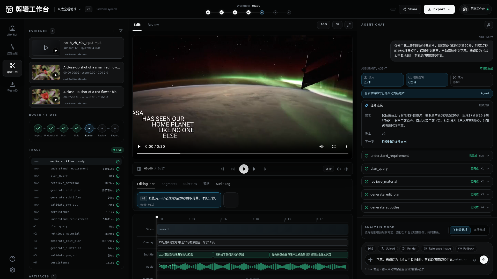

# 剪辑工作台演示

这里展示自然语言剪辑、多轮修改、版本回滚和视频译制。录屏来自实际网站操作，成片由工作台调用本地模型与 FFmpeg 导出。

| 演示 | 内容 |
| --- | --- |
| [04 · 自然语言剪辑与多轮修改](04-editing-workflow.mp4) | 上传原片、查看分析结果，用文字生成第一版，再缩短片段、精简字幕，导出后回滚恢复第一版。 |
| [05 · 原片与两版成片对照](05-editing-comparison.mp4) | 原片节选 → 17 秒第一版 → 9 秒修改版，保留实际中文音轨。 |
| [06 · 9 秒中文剪辑成片](06-edited-chinese.mp4) | 工作台直接下载的修改版 MP4，包含原声和烧录中文字幕。 |
| [01 · 文本驱动译制](01-agent-workflow.mp4) | 上传中文口播，载入原片字幕并校订，发送「翻译成英文并配音」，试听、确认并下载。 |
| [02 · 面板逐步译制](02-panel-workflow.mp4) | 从已有字幕时间线开始，在面板完成术语、翻译、配音和交付操作。 |
| [03 · 30 秒英文成片](03-earth-english.mp4) | 实际 Qwen 翻译、Piper 英文配音及 FFmpeg 双语字幕输出，含音轨。 |

点击链接打开或下载 MP4。04 为无声操作录屏，模型和渲染等待段已剪短，顶栏标注实际耗时；05 保留实际音轨，原片播放前 8 秒，两版成片完整播放；06 保留实际下载文件。



## 复现剪辑演示

1. 新建项目，上传 30 秒带中文旁白的地球科普原片，等待原片分析与语音识别完成。
2. 输入：`仅使用我上传的地球科普原片，截取原片第3秒到第20秒，剪成17秒的16:9横屏短片，保留中文原声，自动添加中文字幕。标题设为《从太空看地球》，剪辑说明用简短中文。`
3. 查看时间线，导出、播放并下载第一版。
4. 继续输入：`把原片范围改为第3秒到第12秒，成片缩短到9秒；中文字幕改得更简短，保持中文原声和16:9横屏。`
5. 查看新版本、播放并下载修改版，点击回滚恢复第一版时间线。

录制脚本位于 `apps/web/e2e/editing-demo.spec.ts`，通过真实界面提交要求，并检查两版时长、字幕措辞精简、浏览器播放、MP4 下载与回滚结果。打包脚本为 `scripts/package_editing_demo.py`。

已有模型和 Compose 就绪后，可使用自己的 30 秒中文旁白视频复现同样的裁剪指令：

```bash
CAMCAT_EDITING_DEMO_VIDEO=/data/zjr/camcat_studio/demos/user_trial_20261115/earth_zh_30s_input.mp4 \
CAMCAT_E2E_OUTPUT_DIR=/data/zjr/camcat_studio/checks/editing-demo/results \
bash scripts/studio.sh browser editing-demo.spec.ts --workers=1 --reporter=json

python scripts/package_editing_demo.py \
  --results /data/zjr/camcat_studio/checks/editing-demo/results \
  --output /data/zjr/camcat_studio/demos/editing-demo
```

原片只在本机数据目录保留，仓库提供派生录屏与成片。
剪辑文件摘要、时间线版本和实测耗时见 [editing-manifest.json](editing-manifest.json)。

## 复现译制演示

1. 新建项目，上传带口播的原片并等待分析。
2. 在「译制」载入原片和识别字幕，校订错词及每句时间。
3. 输入「把原文字幕翻译成英文并配音，允许一次时长改写，替换原声」。
4. 等待草稿版本生成，打开「译制」试听、校订，再确认交付审校。
5. 生成交付视频，预览并下载 ZIP，也可全程通过面板逐步处理。

01 的中文脚本为自撰输入，识别错词由界面校订；译文、配音和视频来自真实服务。02 使用自撰的原文校订输入。01 剪短了等待段，02 为连续操作录屏；配音效果可播放 03。译制文件摘要见 [manifest.json](manifest.json)。

## 来源

- 地球画面：[NASA — Seeing Earth as Only NASA Can](https://svs.gsfc.nasa.gov/14831/)，Credit: NASA；源视频的 Universal Production Music 音轨已移除。
- 面板演示背景：[MDN flower.webm](https://interactive-examples.mdn.mozilla.net/media/cc0-videos/flower.webm)，[上游 CC0 许可](https://github.com/mdn/interactive-examples/blob/13024db581b08fae11a0ca229497198b9b0534e7/LICENSE)；用于识别链路的短语音来自 [FLEURS](https://huggingface.co/datasets/google/fleurs)，CC BY 4.0。
- 英文音轨：本地 Piper `en_US-lessac-medium`，权重版本及 [MODEL_CARD](https://huggingface.co/rhasspy/piper-voices/blob/b145f2ac26522d6a2ccde0164b7b0e48b1e3199c/en/en_US/lessac/medium/MODEL_CARD) 与数据许可链接保留在部署记录。中文合成输入仅用于本地流程验证，公开文件为操作录屏和英文成片。
- 操作录屏：Playwright 对真实 Compose 网站录制；剪短等待和格式转换使用 FFmpeg。没有替换模型输出、伪造成功响应或合成界面。

文件摘要、实际时长及此次验收范围见 [manifest.json](manifest.json)。源码使用 MIT 许可，第三方媒体及音色适用各自条款。
